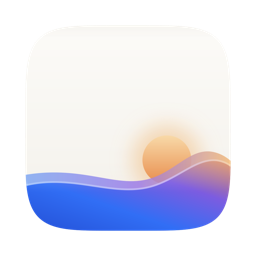

<div align="center">
  
</div>

# Gesso

**A cross-platform dynamic wallpaper engine for Windows and macOS.**
Videos, GIFs, shaders and web pages pinned *behind* your desktop icons — written in Rust with [GPUI](https://gpui.rs).

[Download](https://github.com/zhanglun/gesso/releases) · [简体中文](README.zh-CN.md) · [Architecture](docs/ARCHITECTURE.md) · [Roadmap](docs/ROADMAP.md) · [Security](SECURITY.md) · [Contributing](CONTRIBUTING.md) · [AGENTS.md](AGENTS.md)

> **Status: v0.1.3 released (2026-10-15)** — macOS and Windows are working (unsigned builds). Windows single-display use is verified; multi-display hardware remains a roadmap item.

---

## What it looks like

<!-- TODO: app screenshots (capture real windows only, see docs/RELEASE-CHECKLIST.md):
     
-->

Gesso lives in the menu bar / tray. The manager window holds the wallpaper library, monitor mapping and settings; the wallpaper itself is pinned below the desktop icon layer — your icons stay on top, visible and clickable, while video / shader / web content keeps playing underneath.

## What it does

- **Pinned behind the icons** — the wallpaper window sits *below* the desktop icon layer: your icons stay visible, stay clickable, and keep working.
- **Native video plus a host pipeline** — video (`mp4`/`webm`) uses the platform-native player; animated images (`gif`/`webp`), shaders (`glsl`, Shadertoy-style) and web pages (`html`) use the shared sandboxed host page.
- **Remote pages, zero copy** — paste any `https://` URL in the library toolbar to use a live web page as wallpaper (no local files); Wallpaper Engine `project.json` imports are also read-only references.
- **Real pause** — pausing stops the JS render loop and video decoding, not just the visuals. Full-screen apps and battery mode will pause automatically (see [Roadmap](docs/ROADMAP.md)).
- **Tray-first UX** — pause/resume and switch wallpapers from the menu bar; open the manager window only when you want to manage content.
- **No IPC into the app** — wallpaper content is treated as untrusted: it runs in a sandboxed webview and receives only the host's typed pause, frame-rate and input events.

## Get it

Download from [GitHub Releases](https://github.com/zhanglun/gesso/releases): macOS `.dmg`, Windows installer or portable `.zip`.

Builds are **not signed or notarized** (see [Roadmap](docs/ROADMAP.md)), so the first launch needs one extra step:

- **macOS**: right-click the app → **Open** → **Open** (or `xattr -dr com.apple.quarantine /Applications/Gesso.app` in Terminal).
- **Windows**: SmartScreen → **More info** → **Run anyway**.

## Platform status

| Platform | Wallpaper pinning | Notes |
|---|---|---|
| **macOS** | ✅ working | `NSWindow` below the icon layer (`level = -2147483604`), click-through, all-spaces; verified on macOS with a full-screen video wallpaper |
| **Windows** | ✅ working | Own Win32 window + WebView2 child mounted under the icon layer via the WorkerW ladder (`Progman 0x052C` → `SetParent`), click-through, PMv2 DPI, explorer-restart self-heal; verified on real hardware (single display) |
| **Linux** | ❌ out of scope (v1) | KDE/GNOME/X11/Wayland would each need a separate desktop-integration path — Linux is out of scope for v1 |

| Feature | Status |
|---|---|
| Video wallpaper, pinned & full-screen | ✅ |
| Pause / resume from tray (stops decoding, not just visuals) | ✅ |
| Config persistence (restores on launch) | ✅ |
| Monitor enumeration with platform IDs (EDID/PnP first, platform fallback) | ✅ |
| Manager UI (library / monitors / settings) | ✅ |
| Import files (dialog + drag & drop) | ✅ |
| Settings persistence, autostart | ✅ |
| Shader renderer (Shadertoy subset, WebGL2) | ✅ |
| HTML renderer (sandboxed iframe, no Rust IPC) | ✅ |
| System data bridge (fullscreen/battery auto-pause · time · cursor · idle) | ✅ |
| Wallpaper Engine `video`/`web` wallpapers (user-driven import, read-only) | ✅ — see [docs/WALLPAPER-ENGINE.md](docs/WALLPAPER-ENGINE.md) |

## Built-in wallpapers

Ten samples register on first launch, so the app is useful before you import anything: **Spectrum** (video), **Plasma**, **Aurora**, **Noise Flow**, **Cursor Glow**, **Tide**, **Starfield**, **Silk** and **Ember** (shaders), plus **Clock** (web page). Your own `mp4` / `webm` / `gif` / `webp` / `glsl` / `html` files — or any `https://` URL — can be added from the library.

## For developers

**Requirements**

- **macOS**: Command Line Tools are enough — **Xcode is not required** (Metal shaders are compiled at runtime via the `runtime_shaders` feature in the GPUI snapshot we depend on).
- **Windows**: MSVC toolchain (WebView2 SDK ships with it); runs verified on real hardware.
- **Rust**: recent stable (developed on 1.99, matching CI).

**Quick start**

```bash
git clone https://github.com/zhanglun/gesso.git && cd gesso
cargo run -p gesso-app          # tray icon + manager window + wallpaper
```

First launch registers the built-in sample wallpapers and assigns one to the main display.

**Useful commands**

```bash
cargo test  -p gesso-core -p gesso-app    # logic tests (fast)
cargo clippy -p gesso-core --all-targets -- -D warnings
pkill -f "target/debug/gesso"             # quit (single-instance lock)
```

<details>
<summary><b>Where your files live</b></summary>

Everything the app creates stays under:

```
~/Library/Application Support/Gesso/     # macOS   (Windows: %USERPROFILE%\.gesso)
├── config.json         # monitor → wallpaper mapping + settings
└── library/
    └── <entry-id>/     # self-contained entry assets (index.<ext> / wallpaper.html);
                        # the host page is served by the app via gesso://host
```

</details>

**Architecture at a glance**

```
tray + manager window ── GPUI ──────────┐
                                        │  EngineAction queue (UI → engine)
                                        ▼
                              ┌────────────────────┐
                              │   SessionManager    │  one session per monitor
                              │   state machine     │  Idle→Loading→Playing→Paused…
                              └───────┬────────────┘
                     pin layer (platform)         content library + config
                              │
              ┌───────────────▼───────────────────────────┐
              │  wallpaper windows = native platform windows │ macOS: AppKit / AVPlayerLayer
              │  WebView for non-video content              │ Windows: WorkerW / MF + DXGI
              └─────────────────────────────────────────────┘
```

Key rule: **wallpaper windows are native windows we own, not GPUI windows.** GPUI manages the manager window and tray only — the macOS layering spike showed GPUI's window coordinator keeps rewriting desktop-level fullscreen window geometry, so wallpaper windows bypass it entirely. Details: [docs/ARCHITECTURE.md](docs/ARCHITECTURE.md) · engine API: [crates/app/API.md](crates/app/API.md) · engineering rules & pitfalls: [docs/ENGINEERING-NOTES.md](docs/ENGINEERING-NOTES.md).

## Documentation

| Doc | Contents |
|---|---|
| [docs/ARCHITECTURE.md](docs/ARCHITECTURE.md) | Layers, window model, pinning parameters, content pipeline, state machine, security |
| [docs/ENGINEERING-NOTES.md](docs/ENGINEERING-NOTES.md) | Architecture rules, platform discipline, high-risk debugging paths |
| [crates/app/API.md](crates/app/API.md) | The interface UI code uses to talk to the engine |
| [docs/ROADMAP.md](docs/ROADMAP.md) | Current status, known gaps, next priorities |
| [docs/DEVELOPMENT.md](docs/DEVELOPMENT.md) | Local development & debugging guide (logs, diagnostics, troubleshooting) |
| [docs/design/技术方案.md](docs/design/技术方案.md) | Current implementation details (Chinese) |
| [docs/WALLPAPER-ENGINE.md](docs/WALLPAPER-ENGINE.md) | Workshop asset compatibility plan and its legal boundary |
| [docs/archive/SPIKE-REPORT.md](docs/archive/SPIKE-REPORT.md) | Archived feasibility spike results (historical) |

## Credits & prior art

- [Lively Wallpaper](https://github.com/rocksdanister/lively) — reference for the Windows `WorkerW` approach.
- [Plash](https://github.com/sindresorhus/Plash) (historical, MIT) — reference for macOS desktop-level window placement.
- [gpui-kit](https://github.com/longbridge/gpui-kit) / [Zed's GPUI](https://github.com/zed-industries/zed) — UI framework and components.
- [wry](https://github.com/tauri-apps/wry) (via `lb-wry`) — webview embedding.
- Icons: [Lucide](https://lucide.dev) via `gpui-kit-assets`.

## License

Dual-licensed under either of [MIT](LICENSE-MIT) or [Apache-2.0](LICENSE-APACHE), at your option.

Wallpaper Engine is a trademark of its respective owner. Gesso is not affiliated with Wallpaper Engine and does not bundle, download or redistribute workshop content.
